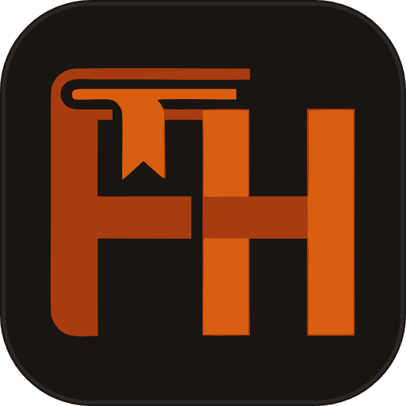

# FolioHaven PC (Desktop Client)

<p align="center">
  
</p>

<p align="center">
  <strong>Serene Digital Bookshelf & Distraction-Free Ebook Reader — Desktop PC Edition</strong><br>
  Built with Flutter &amp; Dart for Windows, Linux, and macOS • 100% Offline • Pure Literary Craft
</p>

<p align="center">
  <a href="https://github.com/FeurisPT2/Foliohaven-pc"></a>
  <a href="https://github.com/FeurisPT2/foliohaven-mobile"></a>
  <a href="https://github.com/FeurisPT2/foliohaven"></a>
  <a href="LICENSE"></a>
</p>

---

## 🏛️ Ecosystem Overview

FolioHaven is organized across three dedicated repositories:

| Project | Platform / Technology | Purpose | Repository Link |
| :--- | :--- | :--- | :--- |
| **💻 FolioHaven PC (This Repo)** | Dart &amp; Flutter | High-performance native desktop client for Windows, Linux, and macOS | [FeurisPT2/Foliohaven-pc](https://github.com/FeurisPT2/Foliohaven-pc) |
| **📱 FolioHaven Mobile** | Kotlin &amp; Jetpack Compose | Native Android application with Material 3 design and offline reader | [FeurisPT2/foliohaven-mobile](https://github.com/FeurisPT2/foliohaven-mobile) |
| **🌐 FolioHaven Web** | HTML5, Canvas &amp; Vanilla Web APIs | Official marketing portal &amp; instant in-browser reader deployed to Vercel | [FeurisPT2/foliohaven](https://github.com/FeurisPT2/foliohaven) |

---

## 🌟 Desktop Features

- 📖 **Universal Multi-Format Support:** Read reflowable **EPUB**, fixed-layout **PDF**, **MOBI**, and **TXT** with fluid pagination and chapter navigation.
- 🎨 **Archival Reading Canvas:** 4 ergonomic palettes:
  - ☀️ **Day Mode:** Warm ivory background with deep charcoal typography.
  - 📜 **Sepia Mode:** Archival parchment tone engineered for long study sessions.
  - 🌙 **Night Mode:** OLED-friendly deep dark canvas with muted off-white text.
  - 🪵 **Dark Sepia Mode:** Low-contrast warm night palette for twilight reading.
- ✍️ **Annotation & Study Tools:** 4-color highlighters (*Amber, Emerald, Azure, Rose*), sticky notes drawer, and Table of Contents drawer.
- 📚 **Visual Archival Bookshelf:** 3D embossed book covers with realistic page edge debossing and format tags.
- 🔒 **100% Offline & Private:** No telemetry, no account registration, and zero cloud uploads.

---

## 🛠️ Building & Running Locally

### Prerequisites
- [Flutter SDK](https://docs.flutter.dev/get-started/install) (3.24+ recommended)
- Visual Studio 2022 with Desktop development with C++ (for Windows builds)

### Commands
```bash
# Clone the repository
git clone https://github.com/FeurisPT2/Foliohaven-pc.git
cd Foliohaven-pc

# Install dependencies
flutter pub get

# Run on Windows Desktop in debug mode
flutter run -d windows

# Build optimized release binary
flutter build windows --release
```

Windows release binaries will be generated under `build/windows/x64/runner/Release/`.

---

## 📄 License

Distributed under the terms of the **[MIT License](LICENSE)**.
